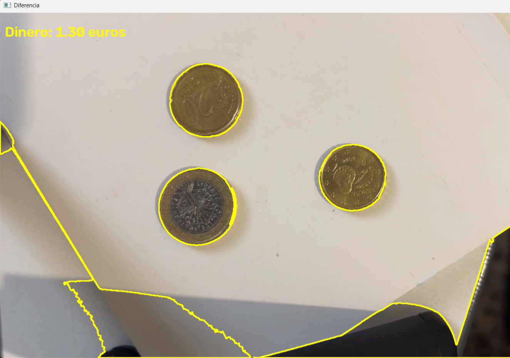
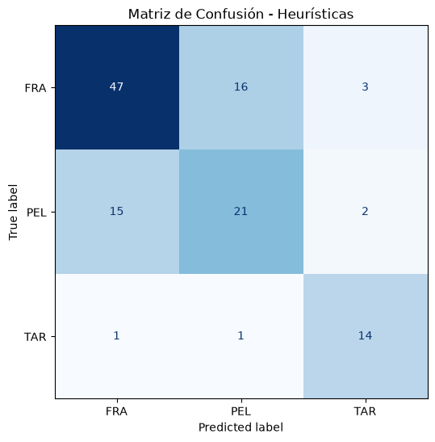

# Práctica 3: Extracción de Características y Clasificación - Visión por Computador

Repositorio de la Práctica 3 de la asignatura Visión por Computador (ULPGC). El proyecto, desarrollado mediante el cuaderno interactivo `VC_P3.ipynb`, aplica análisis espacial de contornos, cálculo de características morfológicas y cromáticas, clasificación basada en heurísticas y un demostrador interactivo en tiempo real.

## Estructura y Requisitos

El entorno de desarrollo requiere Python y las siguientes dependencias estándar: `opencv-python`, `numpy`, `matplotlib`, `pandas` y `scikit-learn`. Para asegurar el correcto funcionamiento del cuaderno, es necesario instalarlas previamente ejecutando los siguientes comandos en la terminal:

```bash
pip install opencv-python
pip install matplotlib
pip install numpy
pip install pandas
pip install scikit-learn
```

El proyecto se organiza de la siguiente manera:

- **`VC_P3.ipynb`**: Cuaderno principal que contiene el código fuente, la ejecución por bloques y la justificación de las decisiones técnicas.
- **`assets/`**: Directorio destinado a almacenar las imágenes originales, las capturas de pantalla, los archivos de anotaciones (CSV) y las demostraciones visuales de los resultados generados.

## Desarrollo de las Tareas y Demostrador

El cuaderno respeta la progresión del guion oficial para dar cumplimiento a las tareas exigidas, incorporando analizadores propios y extractores de métricas en vivo:

- **Tarea 1.1 - Conteo y Valoración de Monedas en Imagen Ideal:** Identificación interactiva de una moneda de referencia (mediante clic del ratón) para establecer un factor de conversión entre píxeles y milímetros. A partir de esa información, se evalúa el diámetro de las demás monedas halladas para sumar el valor total.

  El núcleo del código evalúa el dinero total iterando sobre los contornos encontrados y aplicando tolerancias al tamaño calculado.
  ```python
  if factor_conversion_1_euro is not None:
      dinero_total = 0.0
      tolerancia = 0.5
      
      for c in contornos_grandes:
          __,radio = cv2.minEnclosingCircle(c)
          diametro = radio * 2 / factor_conversion_1_euro
          if abs(diametro - 25.75) <= tolerancia:
              dinero_total += 2.0
          elif abs(diametro - 23.25) <= tolerancia:
              dinero_total += 1.0
          elif abs(diametro - 24.25) <=  tolerancia:
              dinero_total += 0.5
          elif abs(diametro - 22.25) <= tolerancia:
              dinero_total += 0.2
          elif abs(diametro - 19.75) <= tolerancia:
              dinero_total += 0.1
          elif abs(diametro - 21.25) <= tolerancia:  
              dinero_total += 0.05
          elif abs(diametro - 18.75) <= tolerancia:
              dinero_total += 0.02
          elif abs(diametro - 16.25) <= tolerancia:
              dinero_total += 0.01

  print(f"Dinero total: {dinero_total:.2f} euros")
  ```

  


- **Tarea 1.2 - Demostrador en Vivo de Conteo de Monedas:** Aplicación en tiempo real del algoritmo anterior sobre el flujo de vídeo de la cámara web. Tras una calibración inicial, el sistema dibuja los contornos y actualiza la cantidad de euros en pantalla frame a frame.

  Bucle continuo que clasifica en vivo las monedas y renderiza la suma total interactiva.
  ```python
      if factor_conversion_1_euro is not None:
          
          dinero_total = 0.0  
          tolerancia = 0.5

          for c in contornos_grandes:
              cv2.drawContours(frame, [c], -1, (0, 255, 255), 2)
              __,radio = cv2.minEnclosingCircle(c)
              diametro = (radio * 2) / factor_conversion_1_euro

              if abs(diametro - 25.75) <= tolerancia:
                  dinero_total += 2.0
              elif abs(diametro - 23.25) <= tolerancia:
                  dinero_total += 1.0
              elif abs(diametro - 24.25) <=  tolerancia:
                  dinero_total += 0.5
              elif abs(diametro - 22.25) <= tolerancia:  
                  dinero_total += 0.2
              elif abs(diametro - 19.75) <= tolerancia:
                  dinero_total += 0.1
              elif abs(diametro - 21.25) <= tolerancia:  
                  dinero_total += 0.05
              elif abs(diametro - 18.75) <= tolerancia:
                  dinero_total += 0.02
              elif abs(diametro - 16.25) <= tolerancia:
                  dinero_total += 0.01

      cv2.putText(frame, f"Dinero: {dinero_total:.2f} euros", (10, 50), 
                      cv2.FONT_HERSHEY_SIMPLEX, 1, (23, 245, 255), 2)
  ```

  


- **Tarea 2 - Extracción de Características y Clasificación de Microplásticos:** Análisis morfológico (área, perímetro, compacidad, *extent*) y cromático (brillo medio) sobre recortes de partículas guiados por un fichero CSV, finalizando en un sistema de heurísticas para discriminar entre alquitrán (TAR), pellets (PEL) y fragmentos (FRA).
  
  ```python
  def calcular_caracteristicas(contorno, imagen_recorte):
      # 1. Básicas
      area = cv2.contourArea(contorno) 
      perimetro = cv2.arcLength(contorno, True)
      x, y, w, h = cv2.boundingRect(contorno)

      # 2. Relación de aspecto (Ancho / Alto)
      aspect_ratio = float(w) / h if h != 0 else 0

      # 3. Compacidad (Perímetro^2 / Área)
      compacidad = (perimetro ** 2) / area if area != 0 else 0
      
      # 4. Extent (Relación área partícula / área caja delimitadora)
      area_caja = w * h
      extent = area / area_caja if area_caja != 0 else 0
      
      # 5. Color (Brillo medio)
      mascara = np.zeros(imagen_recorte.shape[:2], dtype=np.uint8)
      cv2.drawContours(mascara, [contorno], -1, 255, -1)
      brillo_medio = cv2.mean(imagen_recorte, mask=mascara)[0]

      return [area, perimetro, aspect_ratio, compacidad, extent, brillo_medio]
  ```

  **Evaluación de Rendimiento mediante Matriz de Confusión:** Generación de la gráfica a partir de las predicciones dadas por el sistema basado en heurísticas al evaluarse sobre la imagen `MPs_test.jpg`.
  
  ```python
  # Generar y dibujar la Matriz de Confusión
  # Usamos set() para obtener los nombres únicos de las clases
  etiquetas = sorted(list(set(y_true + y_pred))) 

  cm = confusion_matrix(y_true, y_pred, labels=etiquetas)
  disp = ConfusionMatrixDisplay(confusion_matrix=cm, display_labels=etiquetas)

  fig, ax = plt.subplots(figsize=(6, 6))
  disp.plot(ax=ax, cmap='Blues', colorbar=False)
  plt.title('Matriz de Confusión - Heurísticas')
  plt.show()
  ```

  


## Instrucciones de Uso

Para evaluar el proyecto correctamente y asegurar la estabilidad del entorno:

- Iniciar la sesión en Jupyter Notebook o entorno compatible y abrir el archivo `VC_P3.ipynb`.
- Ejecutar las celdas de forma secuencial para compilar las funciones en el orden establecido.
- En las celdas que invocan la calibración (clic en la moneda de 1€) o la cámara web, es indispensable mantener el foco en la ventana emergente de OpenCV.
- En los demostradores continuos, presionar la tecla `ESC` para liberar el dispositivo de hardware y finalizar el proceso.

## Declaración de Uso de IA

Conforme a las directrices de la asignatura, se declara el uso de herramientas de Inteligencia Artificial bajo un rol estricto de consultoría técnica. Su aplicación se ha limitado a:

- La optimización de los condicionales al evaluar las tolerancias en el cálculo de diámetros para la clasificación de los euros.
- La comprensión lógica sobre el empaquetado y desempaquetado de argumentos (`*medidas`) en listas de Python al trabajar con funciones y múltiples variables.
- Consultas sobre el formato adecuado para instanciar e imprimir correctamente una `ConfusionMatrixDisplay` de la librería `scikit-learn` dentro de un entorno de cuaderno interactivo.

## Contribuidores
| Nombre | GitHub |
| :--- | ---: |
| Ricardo García Rodríguez | [Ricardo428](https://github.com/Ricardo428) |
| Juan Daniel López Melainine | [0nick3r](https://github.com/0nick3r) |
