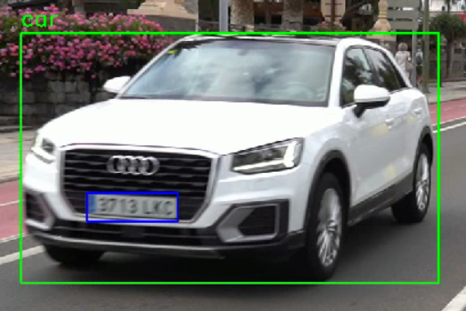
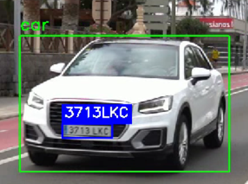
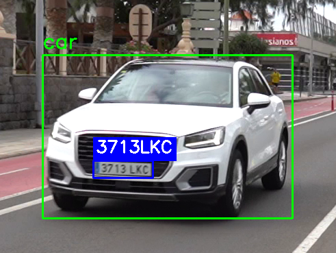

# Práctica 4: Detección y Seguimiento de Vehículos y Matrículas - Visión por Computador

Repositorio de la Práctica 4 (Parte A - Detección) de la asignatura Visión por Computador (ULPGC). El proyecto, desarrollado mediante el cuaderno interactivo `VC_P4.ipynb`, implementa un sistema automatizado de videovigilancia capaz de detectar y realizar seguimiento (tracking) de personas y vehículos, extraer la región de interés (ROI) de los coches y localizar sus matrículas utilizando modelos personalizados basados en redes neuronales (YOLO / RT-DETR).


<br>

## Estructura y Requisitos

El entorno de desarrollo requiere Python (se recomienda versión 3.9.5 por compatibilidad futura con OCR) y las siguientes dependencias estándar y de Deep Learning. Para asegurar el correcto funcionamiento del cuaderno, es necesario crear un entorno e instalar las librerías ejecutando los siguientes comandos:

```bash
conda create --name VC_P4 python=3.9.5
conda activate VC_P4
pip install ultralytics
pip install opencv-python numpy pandas matplotlib
pip install lapx  
pip install paddlepaddle paddleocr
pip install transformers
```
<br>
El proyecto se organiza de la siguiente manera:

| Archivo / carpeta | Contenido |
| :--- | :--- |
| `VC_P4.ipynb` | Cuaderno principal: detección, seguimiento, localización y lectura de matrículas, y generación del vídeo y el CSV. |
| `Comparativa.ipynb` | Cuaderno con la comparativa entre PaddleOCR y SmolVLM. |
| `matriculas_best.pt` | Modelo YOLO entrenado para detectar matrículas. |
| `fotos/` | Imágenes de test usadas en la comparativa. El nombre de cada archivo es su matrícula real. |
| `assets/` | Vídeo de test y resultados obtenidos de las ejecuciones (csv / mp4 ). |

<br>
<br>

## Desarrollo de las Tareas y Demostrador

El cuaderno aborda la detección integral combinando un modelo preentrenado general y un modelo de entrenamiento propio, cumpliendo con los requisitos de la práctica:


### 1. Detección y seguimiento de personas y vehículos

Se usa el modelo preentrenado `yolo11n.pt` (dataset COCO) con su seguimiento integrado.
El número de objetos distintos de cada clase se obtiene guardando sus identificadores en un conjunto (`set`), de modo que un mismo coche visto en muchos fotogramas solo cuenta una vez

```python

total_clases = {
    0: set(),  # persons
    2: set(),  # cars
    3: set(),  # motorcycles
    5: set(),  # trucks
    7: set()   # buses
}

results = model.track(source=frame, persist=True, imgsz=320, verbose=False,classes=list(total_clases))
```

### 2. Localización de la matrícula
 
La matrícula se busca **dentro del recorte de cada vehiculo**, con nuestro modelo `matriculas_best.pt`. Como las coordenadas que devuelve el modelo son relativas al recorte, se les suma la esquina del vehículo para obtener su posición en el fotograma.
 
Los recortes se hacen siempre sobre una copia limpia del fotograma (`limpio = frame.copy()`), para que las cajas dibujadas no aparezcan en la imagen que recibe el OCR.
 
```python
results2 = model2(source=limpio[y1:y2, x1:x2], imgsz=640, conf=0.15, verbose=False)
 
if len(results2[0].boxes) > 0:
    box2 = results2[0].boxes[int(results2[0].boxes.conf.argmax())]
    x1_2, y1_2, x2_2, y2_2 = (int(v) for v in box2.xyxy[0])
    g_x1, g_y1 = x1 + x1_2, y1 + y1_2      
    g_x2, g_y2 = x1 + x2_2, y1 + y2_2
```

### 3. Lectura de la matrícula
 
Antes de pasar la matrícula al OCR, el recorte se amplía a un mínimo de 80 px de alto y se añade un borde para minimizar posibles fallos por imagenes pequeñas o pegadas al borde. 
 
```python
def preparar_recorte(img):
    factor = max(1.0, 80 / img.shape[0])
    img = cv2.resize(img, None, fx=factor, fy=factor, interpolation=cv2.INTER_CUBIC)
    return cv2.copyMakeBorder(img, 10, 10, 10, 10, cv2.BORDER_REPLICATE)
```

- **PaddleOCR** devuelve el texto en varios fragmentos (por ejemplo `"1234"` y `"ABC"`), que se unen y se limpian:
    
    ```python
    result = ocr.predict(matricula_recortada)[0]
    crudo = re.sub(r'[^A-Z0-9]', '', ''.join(result['rec_texts']).upper())
    ```

- **SmolVLM** Funciona como un chat: recibe la imagen junto a una instrucción y genera la respuesta.
 
    ```python
    PROMPT = "Read the license plate in this image. Answer only with the letters and numbers of the plate."
    
    def leer_matricula_vlm(img_bgr):
        imagen = Image.fromarray(cv2.cvtColor(img_bgr, cv2.COLOR_BGR2RGB))
        mensajes = [{"role": "user", "content": [{"type": "image"}, {"type": "text", "text": PROMPT}]}]
        prompt = processor.apply_chat_template(mensajes, add_generation_prompt=True)
        inputs = processor(text=prompt, images=[imagen], return_tensors="pt").to(Device, dtype=DTYPE)
        salida = model_ocr.generate(**inputs, max_new_tokens=15, do_sample=False)
        nuevos = salida[:, inputs["input_ids"].shape[1]:]
        return processor.batch_decode(nuevos, skip_special_tokens=True)[0].strip()
    ```
 
En los dos casos, la lectura se valida con el **formato de matrícula español**.
 
```python
patrones_matricula = [re.compile(r'\d{4}[A-Z]{3}'),                
                      re.compile(r'[A-Z]{1,2}\d{4}[A-Z]{1,2}')]    
```

### 4. Salida: vídeo y CSV
 
En el vídeo, cada vehículo aparece con una caja verde, su matrícula con una caja azul y, encima, la matrícula leída.
 
| Sin OCR | PaddleOCR | SmolVLM |
| :---: | :---: | :---: |
|  |  |  |
 
El CSV contiene una fila por cada objeto detectado en cada fotograma:
 
| Columna | Descripción |
| :--- | :--- |
| `frame` | Número de fotograma. |
| `class`, `confidence` | Clase detectada y confianza de la detección. |
| `track_id` | Identificador de seguimiento (-1 si no tiene). |
| `x1, y1, x2, y2` | Caja del objeto. |
| `matrícula_en_su_caso`, `confianza` | 1 si se ha detectado matrícula, y confianza de esa detección. |
| `mx1, my1, mx2, my2` | Caja de la matrícula en el fotograma. |
| `texto_matricula` | Matrícula leída por el OCR. |

<br> 
 
Recuento de objetos distintos en el vídeo de test:

| Clase | Objetos distintos |
| :--- | :---: |
| Persona | 10 |
| Coche | 28 |
| Moto | 2 |
| Autobús | 1 |
| Camión | 3 |
 
<br>

## Comparativa OCR clásico vs VLM
 
### Conjunto de prueba
 
Se han usado **50 imágenes** del conjunto de test del dataset de matrículas. Se ha anotado a mano renombrando cada imagen con su matrícula (`1234ABC.jpg`), y se han descartado las imágenes en las que la matrícula no era legible a simple vista.

<br>

### Máquina de pruebas
 
| Componente | Especificación |
| :--- | :--- |
| Sistema operativo | Windows-10-10.0.26200-SP0 |
| CPU | AMD64 Family 25 Model 117 Stepping 2, AuthenticAMD |
| GPU | NVIDIA GeForce RTX 5060 |
| Dispositivo usado | cuda |

<br>

## Resultados

Se consideran dos métricas:
 
- **Tasa de acierto**: porcentaje de matrículas leídas completas y sin errores.
- **Tiempo medio de inferencia**: milisegundos por matrícula.

<br>

| Modelo | Nº imagenes | % Aciertos | Tiempo medio |
| :--- | :--- | :--- | :--- |
| PaddleOCR | 50 imágenes | 40.0 % | 829 ms |
| SmolVLM | 50 imágenes | 86.0 % | 548 ms |


### Conclusiones
---
SmolVLM ha obtenido mejores resultados en las dos métricas. Acierta el 86 % de las matrículas frente al 40 % de PaddleOCR, más del doble, y además es aproximadamente 1,5 veces más rápido (548 ms frente a 829 ms por matrícula)

Por estos resultados, se ha elegido SmolVLM como OCR del sistema.


<br>


## Instrucciones de Uso

Para evaluar el proyecto correctamente y asegurar la estabilidad del entorno:

1. Clonar el repositorio y asegurar que los modelos `.pt` (`yolo11n.pt` y el modelo entrenado de matrículas) se encuentren en la raíz del proyecto.
2. Iniciar la sesión en Jupyter Notebook y abrir el archivo `VC_P4.ipynb`.
3. Descargar el archivo de test [video](https://drive.google.com/file/d/1jQa2iCTIDOyzp85Me7nk2g7a3YAy2zcL/view?usp=sharing) y añadirlo a la carpeta assets.
4. Ejecutar las celdas de forma secuencial. El procesamiento del vídeo está configurado sin `show=True` por cada frame interno para no colapsar la RAM de Jupyter.
5. El proceso generará automáticamente un vídeo renderizado final y un archivo dependiendo del modelo de OCR usado en el directorio assets. Para detener un proceso en vivo (webcam), presionar la tecla `ESC`.
6. Si se quiere ejecutar las comparativas se debe descargar la carpeta con las 50 imagenes [enlace](https://drive.google.com/drive/folders/1sCZJWR31f8fEuQ8b2OPxuRr-yUnVXdTW?usp=sharing)

<br>

## Declaración de Uso de IA

Conforme a las directrices de la asignatura, se declara el uso de herramientas de Inteligencia Artificial bajo un rol estricto de consultoría técnica.

<br>

## Contribuidores
| Nombre | GitHub |
| :--- | ---: |
| Ricardo García Rodríguez | [Ricardo428](https://github.com/Ricardo428) |
| Juan Daniel López Melainine | [0nick3r](https://github.com/0nick3r) |