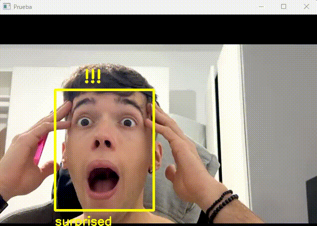
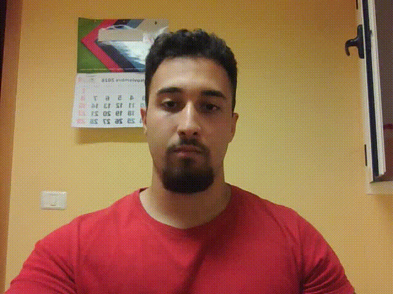

# Práctica 5: Biometría: Detección y caracterización de caras - Visión por Computador

Repositorio de la Práctica 5 de la asignatura Visión por Computador (ULPGC). El trabajo consta de **dos prototipos que reaccionan a la información extraída del rostro**:

- **Prototipo 1 (Parte 1):** clasificador de emociones entrenado por nosotros (FaceNet, HOG y LBP con SVM) y probado en tiempo real con webcam.
- **Prototipo 2 (Parte 2, estilo libre):** espejo interactivo que usa los landmarks y las expresiones faciales de MediaPipe para deformar la imagen y colocar objetos de realidad aumentada.

<br>

## Demostración

| Prototipo 1: clasificador de emociones | Prototipo 2: espejo interactivo |
| :---: | :---: |
|  |  |

<br>

## Estructura y requisitos

El entorno se basa en el de la práctica (Python 3.11.5). Para ejecutar los cuadernos:

```bash
conda create --name VC_P5 python=3.11.5
conda activate VC_P5
pip install matplotlib scikit-learn scikit-image joblib
pip install mtcnn tensorflow deepface tf-keras
pip install opencv-python==4.12.0.88
pip install mediapipe
```

| Archivo / carpeta | Contenido |
| :--- | :--- |
| `VC_P5_entrenar_modelo.ipynb` | Prototipo 1: extracción de características, entrenamiento y evaluación de los clasificadores de emociones, y prueba en tiempo real. |
| `VC_P5_espejo_feria.ipynb` | Prototipo 2: espejo interactivo con MediaPipe. |
| `face_landmarker.task` | Modelo de MediaPipe (landmarks y expresiones faciales) que usa el prototipo 2. |
| `assets/` | GIFs de demostración de los dos prototipos. |

El conjunto de datos de emociones no se incluye en el repositorio. El cuaderno del prototipo 1 espera encontrarlo en `dataset_emotions/train` y `dataset_emotions/test`, con una carpeta por emoción (fuente del dataset: *completar*).

<br>

## Escenarios de aplicación

**Escenario 1: interfaces que reaccionan a la emoción del usuario.** Un sistema que reconoce en tiempo real la emoción de la persona frente a la cámara y responde visualmente. Es la base de aplicaciones como kioscos o pantallas interactivas que se adaptan al estado emocional, videojuegos con reacción al jugador o medición de la respuesta de un público.

**Escenario 2: espejo interactivo para ferias, museos y eventos.** Un visitante se coloca frente a la cámara y, sin tocar nada, controla el espejo con la cara: sus gestos deforman la imagen y un parpadeo largo sortea un accesorio de realidad aumentada. El objetivo es entretener y atraer a la gente a un stand, de forma que cualquiera pueda usarlo en segundos.

<br>

## Prototipo 1: clasificador de emociones

### Datos

El conjunto tiene **5 emociones** (enfado, miedo, felicidad, tristeza y sorpresa), con imágenes de 48×48 píxeles y **perfectamente balanceado**:

| Conjunto | Imágenes por clase | Total |
| :--- | :---: | :---: |
| Entrenamiento | 3000 | 15000 |
| Test | 800 | 4000 |

### Características y clasificadores

Se extraen tres tipos de características de cada imagen y se prueban por separado y combinadas:

| Característica | Dimensión | Descripción |
| :--- | :---: | :--- |
| FaceNet | 128 | Embedding de la cara obtenido con DeepFace. |
| HOG | 288 | Histogramas de gradientes orientados en una rejilla de 6×6 celdas. |
| LBP | 531 | Patrones binarios locales (`nri_uniform`, 59 bins) en una rejilla de 3×3 celdas. |

Los clasificadores son un **KNN** (k = 11) y una **SVM con núcleo RBF**. Para la SVM se normaliza con `MinMaxScaler` y se busca la mejor configuración con `GridSearchCV` (validación cruzada de 5 particiones, C en {1, 10, 100} y gamma en {scale, 0.01, 0.1}, con pesos de clase balanceados). La evaluación se hace siempre sobre el conjunto de test, que no interviene en el entrenamiento.

### Resultados

| Modelo | Exactitud en test |
| :--- | :---: |
| FaceNet + KNN | 0.42 |
| LBP + SVM | 0.53 |
| HOG + SVM | 0.55 |
| FaceNet + SVM | 0.56 |
| FaceNet + HOG + SVM | 0.60 |
| **FaceNet + HOG + LBP + SVM** | **0.62** |

Con cinco clases el azar da 0.20, así que el modelo final lo triplica. Los puntos que más destacan:

- **Combinar características mejora** frente a cada una por separado: pasar de FaceNet a FaceNet + HOG + LBP sube la exactitud de 0.56 a 0.62.
- **La SVM supera claramente al KNN** con las mismas características (0.56 frente a 0.42).
- **Por clase,** las mejores son sorpresa (F1 0.79) y felicidad (0.75). La peor es miedo (0.47).
- **La confusión más frecuente es entre miedo y tristeza:** 195 de las 800 imágenes de miedo se clasifican como tristeza, y 128 de las 800 de tristeza como miedo.
- **Coste:** el modelo final tardó unos 43 minutos en entrenarse (con la búsqueda de parámetros) y unos 30 segundos en predecir las 4000 imágenes de test.

El modelo final se guarda en `modelo_emociones_tri.joblib` junto con su normalizador y los parámetros de las características.

### Prueba en tiempo real

1. **MTCNN** detecta las caras de cada fotograma de la webcam.
2. Cada cara se recorta, se pasa a gris y se redimensiona a 48×48, y se calculan FaceNet, HOG y LBP.
3. Se clasifica **uno de cada tres fotogramas** para mantener la fluidez, y se queda la emoción más votada entre las **8 últimas predicciones**, para que no parpadee.
4. La reacción es un recuadro de color y un símbolo propios de cada emoción.

| Emoción | Reacción |
| :--- | :--- |
| Felicidad | Recuadro dorado y `:D` |
| Tristeza | Recuadro azul y `;(` |
| Enfado | Recuadro rojo y `GRRR` |
| Sorpresa | Recuadro amarillo y `!!!` |
| Miedo | Recuadro morado y `AAH` |

<br>

## Prototipo 2: espejo interactivo

### Qué hace

Frente a la webcam, el espejo detecta la cara, mide la expresión y reacciona:

| Gesto | Cómo se mide | Reacción |
| :--- | :--- | :--- |
| Sonrisa | Sonrisa de las comisuras (`mouthSmileLeft` y `mouthSmileRight`) | La nariz y las mejillas se ensanchan, con un tinte cálido. |
| Ceño fruncido | Cejas hacia abajo (`browDownLeft` y `browDownRight`) | La zona central se contrae, la imagen se desatura y aparece una viñeta. |
| Sorpresa | Cejas arriba (`browInnerUp`, `browOuterUp`) **y** boca abierta (`jawOpen`) | Los ojos se agrandan y aparecen líneas radiales. |
| Cerrar los dos ojos 1,5 s | `eyeBlinkLeft` y `eyeBlinkRight` | Sortea un accesorio durante 5 s: gafas, corona, nariz y gorro de payaso, o antenas de alienígena. |

Los accesorios se dibujan por código (sin imágenes externas) con sombreado y sombra proyectada, se anclan a los ojos y giran con la inclinación de la cabeza.

### Detección y landmarks

Se usa **MediaPipe Face Landmarker**, que da 478 landmarks y 52 coeficientes de expresión (*blendshapes*) por cara. Con los landmarks se calculan:

- el **punto de la nariz** (landmark 1), centro de las deformaciones;
- el **centro de cada ojo**, como punto medio de sus esquinas (landmarks 33 y 133 para un ojo, 362 y 263 para el otro);
- la **distancia entre ojos**, que sirve de escala para el tamaño de objetos y efectos;
- el **ángulo de la línea de los ojos**, que gira los objetos con la cabeza.

### Decisiones de diseño para que sea robusto

| Problema | Solución |
| :--- | :--- |
| Cada persona y cámara da valores de expresión distintos. | **Calibración** de 2 s con la cara neutra al arrancar (tecla `C` para repetirla); las expresiones se miden respecto a esa base. |
| Los objetos y efectos temblaban de un fotograma a otro. | Detección en modo vídeo (con seguimiento) y **suavizado exponencial** de posición, escala y ángulo. |
| Una risa con la boca abierta se confundía con sorpresa. | La sorpresa exige **cejas levantadas y boca abierta a la vez**. |
| Varias personas delante de la cámara. | Se procesa la **cara más grande**, es decir, la más cercana. |
| Cambios bruscos entre efectos. | La intensidad se suaviza y el efecto activo se desvanece antes de pasar al siguiente. |
| Se pierde la cara un instante. | Durante unos fotogramas se mantienen el objeto y el efecto, que se va desvaneciendo, en la última posición; si la cara no vuelve, desaparecen. |
| Bordes negros al deformar cerca del borde de la imagen. | La deformación replica el borde del fotograma. |
| Webcams con otra proporción que 4:3. | La imagen se recorta al centro en 4:3 antes de procesarse. |
| Coste de dibujar los objetos en cada fotograma. | Cada accesorio se dibuja una vez por tamaño y se reutiliza (caché). |

### Controles

| Tecla | Acción |
| :---: | :--- |
| `C` | Repetir la calibración (cara neutra durante 2 s). |
| `L` | Mostrar u ocultar la malla de landmarks. |
| `H` | Mostrar u ocultar el panel con la expresión, el objeto y los FPS. |
| `R` | Empezar o parar la grabación en `espejo_feria.mp4` (se detiene sola a los 30 s). |
| `ESC` | Salir. |

### Limitaciones

- Los objetos solo giran en el plano de la imagen: si la cabeza se gira de lado o se inclina hacia delante, no siguen la perspectiva.
- Los umbrales de cada gesto son empíricos y están al principio del código para ajustarlos.
- Solo reacciona a una persona a la vez.
- Solo se ha probado con MediaPipe; no se ha comparado con otros detectores faciales.

<br>

## Instrucciones de uso

1. Clonar el repositorio y crear el entorno `VC_P5` como se indica arriba.
2. **Prototipo 1:** colocar el dataset en `dataset_emotions/` y ejecutar `VC_P5_entrenar_modelo.ipynb` de forma secuencial. Las celdas de extracción y de entrenamiento son lentas (el entrenamiento de las SVM tarda decenas de minutos); los resultados intermedios se guardan en `embeddings.npz`, `descriptores.npz` y en los `.joblib`. La última celda abre la webcam y se cierra con `ESC`.
3. **Prototipo 2:** ejecutar `VC_P5_espejo_feria.ipynb`. Si no existe `face_landmarker.task`, la segunda celda lo descarga. Al arrancar, mantener la cara neutra 2 segundos mientras se calibra.

<br>

## Declaración de Uso de IA

Se ha utilizado Claude y Gemini como asistente durante la práctica: para revisar, depurar y refactorizar el código y para pulir el README. El diseño de los prototipos, el entrenamiento de los modelos, la ejecución de los experimentos y la revisión de los resultados han sido realizados por los autores Ricardo García Rodríguez y Juan Daniel López Melainine.

<br>

## Contribuidores

| Nombre | GitHub |
| :--- | ---: |
| Ricardo García Rodríguez | [Ricardo428](https://github.com/Ricardo428) |
| Juan Daniel López Melainine | [0nick3r](https://github.com/0nick3r) |
